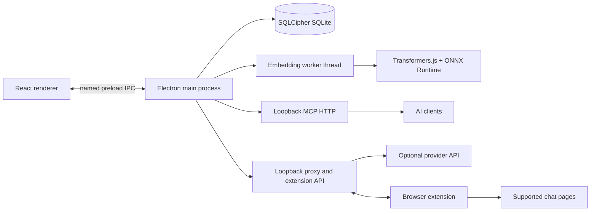

# Architecture

One Brain is an Electron desktop app with a React renderer and plain JavaScript services in the main process. Persistent memory and connection state are local to the app's user-data directory.

## Main pieces

- `electron/main.js` owns startup, windows, IPC handlers, local services, locking, and lifecycle logging.
- `electron/preload.js` exposes a limited `window.brain` API. The renderer has no Node integration.
- `electron/db.js` manages SQLCipher, memories, FTS5 search, links, embeddings, and retrieval evaluation.
- `electron/embedder.js` runs `electron/embedder-worker.mjs` in a worker thread. Transformers.js provides feature extraction; `onnxruntime-node` executes the model. The pinned multilingual MiniLM model is downloaded on first use and cached under user data.
- `electron/mcp-server.js` serves MCP over authenticated loopback Streamable HTTP. `scripts/mcp-stdio.js` bridges stdio MCP clients to the local HTTP endpoint.
- `electron/memory-proxy.js` exposes local OpenAI-compatible chat-completions routes for configured provider APIs. The extension API is mounted on the local proxy service.

The release build uses `electron-builder` and `asar`. Native modules and the embedding worker's entry/config files are unpacked so Node can load them. Release CI builds Linux x64, Windows x64, and macOS arm64, then runs the packaged smoke test for each target.

There is no One Brain cloud service or cross-device sync. Provider requests and first-run model downloads do use network access. Not verified: runtime behavior on every supported OS outside CI, or the complete packaged data flow on a clean machine.

See [Connect AI clients](CONNECT-AI.md), [Security](SECURITY.md), the [documentation index](README.md), and the preserved [privacy policy](privacy.md), [security user-data audit](security-userdata-audit.md), and [extension listing](extension-store-listing.md).
